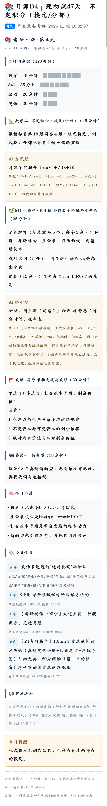
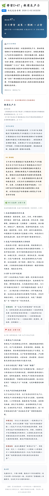
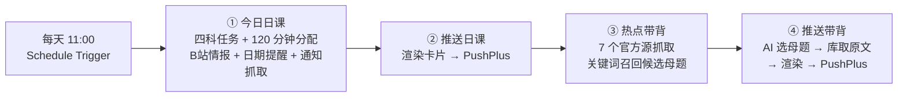
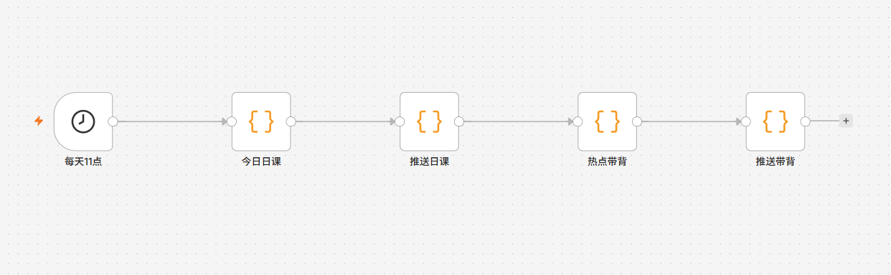
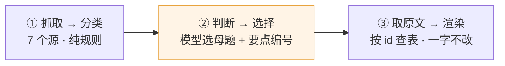

# 考研每日一站 · AI 备考陪伴助手

把一个考生的四科复习，收敛成**每天两条微信消息**：一条说今天练什么，一条说今天背什么。

`n8n` · `DeepSeek` · 政策热点 → 考点映射 · 云端 7×24 运行 · 真实用户每日使用

---

## 一、这个项目解决什么问题

一个独自备考的人，每天面对的真实处境是：

- 官方渠道（研招网、招生单位官网）**一天 59 条通知**，真正和自己有关的 1 条
- 四科复习任务要靠自己排，每天开书前先花 20 分钟想"今天干什么"
- 专业课是学校自命题，政策热点和考点的关系没人替他梳理
- 手机上装了五六个考研 App，打开哪个都要自己筛

这里的判断是：**他缺的不是信息，是"今天到底干什么"这一句话。**

所以产品不做资料库、不做题库、不做社区，只做一件事：每天 11:00，把"今天练什么、今天背什么"两条消息推到他微信上。

## 二、成品长什么样

**第一条 · 考研日课**（管"练什么"）

```
📚 考研日课 · 第 1 天
2026-10-30 周五 · 距初试 50 天 · 今日合计 120 分钟

⚠️ 距初试 10 天 · 准考证下载 + 打印
   · 下载 PDF 后打印 3 份…

⏱ 时间分配（120 分钟）
数学 45 分钟　▉▉▉▉▉▉▉▉▉
841  35 分钟　▉▉▉▉▉▉▉
政治 20 分钟　▉▉▉▉
英语 20 分钟　▉▉▉▉

📐 数学二 · 极限与未定式（45 分钟）+ AI 变式题
🌿 841 · 第 1 练 生态因子与限制（35 分钟）+ 5 个名词 + 成对名词 + 简答
🚩 政治 · 某模块（20 分钟）+ 必背清单
🇬🇧 英语一 · 阅读精读（20 分钟）
📎 今日情报（手动贴的 + B站自动抓的 3 条）
📢 官方通知 · 1 条
   [重点] 招生单位 2027 年推免拟录取名单公示  10-19
```

**第二条 · 今日带背**（管"背什么"）

```
🌿 今日带背 · 政策 → 预测 → 必背
抓取 11 条 → 6 个候选母题 · AI 选出今日 1 个 · 其余后续轮换

🤖 AI 今日研判
本期政策主线是生态环境监测体系与流域治理两条…
预测方向：生态环境监测与评估 · 长江大保护与水域生态

今日重点
长江大保护与水域生态
政策依据：《生态环境监测"十五五"规划》系列解读① 10-22 …

为什么押它
政策层级高且有官方解读稿，理论锚点清晰，最易出论述题。

841 预测题
以长江十年禁渔为例，论述顶级捕食者缺失对食物网结构与
群落稳定性的影响，并说明恢复路径

🌿 841 生态学 · 必背 4 条        ← 库内原文，模型改不了一个字
🚩 政治 · 必背 3 条              ← 库内规范表述
答题框架：生境破碎化 → 营养级联失效 → 演替规律 → 措施 → IBI
```

实际推送：

<p align="center">  
    
  \&nbsp;\&nbsp;\&nbsp;  
    
</p>

分工是刻意的、不重叠的：**日课给动作和时长，带背给理论和原文。**

带背只有一张卡：一个母题全部展开，**不折叠、不放外链**。其余母题不在当天卡片里出现，靠背诵台账（见「四 · 3」）轮换到后面几天。

## 三、架构：一条链，5 个节点



全部逻辑写在 Code 节点里，不依赖任何第三方节点——**5 个节点、一个 Active 开关、一条链路**，部署只有"导入 + 填 key"两步。



原来的三个独立工作流（哨兵 / 日课 / 热点雷达，一天最多 5 条消息、三个开关）是怎么收敛成一个的，见 [docs/01](docs/01-产品设计与需求收敛.md)。

## 四、三个关键设计决策

### 1. 模型是检索器，不是作者

背诵内容的要求是**一个字都不能错**。让大模型生成背诵内容，等于把错误直接推到用户眼前，而且它错得很像对的。

所以内容链路切成三段，模型只负责中间一段：



模型看到的是「今天有什么政策」+「库里有哪些母题、哪些要点编号」，输出的是 `{"id":"yangtze","生态":[1,3],"政治":[1]}` 这样的结构化选择。**它从来没拿到过背诵正文，也就没有能力改一个字。** 返回的 id 越界会被直接丢弃，不会渲染出空标题。

配套的降级也很关键：模型挂了，卡片照发，顶部注明「AI 调用失败，已降级为兜底轮换 + 库内标准设问」——**内容质量降一档，不是降到零。**

完整的三段式链路、内容库设计原则、以及"20 个母题只有 9 个配详解"的取舍，见 [docs/02-内容体系与 AI 边界](docs/02-内容体系与-AI-边界.md)。

### 2. 降噪用黑名单，不用白名单

日均 59 条通知 → 保留 1~2 条，三层过滤：

```
59 条
 ├─ 噪声词丢弃（44 个：大赛/竞赛/论坛/招聘/夏令营/博士/MBA/本科/高考/党建…）
 ├─ 外省口径丢弃（只留「本省 + 全国」，含"教育部"的保留）
 └─ 他校招生宣传丢弃
 ▼
1~2 条 → 分「重点 / 一般」两档
```

这里有个容易做反的选择：**关键词白名单只用来算权重，不用来决定生死。** 真实通知的措辞永远比你想的野，用白名单做主过滤会静默漏掉真正重要的通知。噪声词黑名单漏一条的代价只是多看到一条不相关的——**宁可误留，不可误杀。**

### 3. 防重复要靠数据，不能靠指令

上线一周后收到反馈："好多天都重复。"

原因：模型每次只看"今天的政策"，不知道"昨天背了什么"，同一批政策反复命中同一批母题。写法是在提示词里写一百遍"不要重复"也没用——**模型根本不知道什么是重复。**

改法是加一本**背诵台账**：每次推送后把母题和要点编号写进去（保留 14 天），下次运行时把最近 3 天的记录一起喂给模型，提示词里强制避开；模型挂了走兜底时，也优先挑最近 5 天没背过的母题、最近 3 天没背过的要点编号。这是"产品问题不能靠提示词解决"的一个具体例子。

更多设计细节：[docs/03-降噪与推送设计](docs/03-降噪与推送设计.md)

## 五、内容体系：这才是资产

| 资产         | 规模              | 作用                                 |
| ---------- | --------------- | ---------------------------------- |
| 政策 → 考点映射库 | **20 个母题**      | 每个母题双向落到「生态学理论」和「政治章节」，落不到的不收      |
| 可背诵详解库     | 9 个母题 / 141 条要点 | 每条 100~180 字，"背下来就能写到答题纸上"的长度      |
| 841 专业课题库  | 20 练            | 主题 + 5 个名词 + 1 组成对名词 + 1 道简答       |
| 数学二题库      | 12 练            | 模块 + 题型 + 具体动作（"齐次 2 题 + 非齐次 2 题"） |
| 政治题库       | 12 模块           | 模块 + 单选/多选数量 + 必背清单                |
| 关键日期提醒     | 10 个节点          | 从进度自检到考场落实、准考证、初试、复试               |

映射库的四条设计原则写在文件头：

```
1. 每个母题必须能双向落到「生态学理论」和「政治教材章节」，落不到的不收
2. 生态学锚点按教材章节体系走，保证和教材对得上
3. 政治锚点按考纲五大板块走（马原 / 毛中特 / 史纲 / 思修 / 时政）
4. 「必背」只放官方规范表述，不放推测性内容
```

一个样例：[samples/政策热点-考点映射手册.md](samples/政策热点-考点映射手册.md) ——讲的是判断方法：一条政策值不值得押，看哪三条。

## 六、运行数据

> 统计口径：2026-10-30 首次完整执行（抓取 → 召回 → 研判 → 推送），云端每天 11:00 定时运行

| 指标       | 数值                         |
| -------- | -------------------------- |
| 单日抓取官方通知 | 59 条（3 个源）                 |
| 三层过滤后保留  | 1 条（保留率 ≈ 2%）              |
| 单日抓取政策条目 | 11 条（7 个源）→ 召回 6 个候选母题     |
| 每日推送消息   | 2 条（日课 + 带背）               |
| 单次执行耗时   | 约 1 分钟                     |
| 内容库规模    | 20 母题 / 141 条可背要点 / 44 练题库 |
| 运行方式     | 云服务器 Docker，7×24，不依赖用户开机   |

## 七、快速复现

**本机验证（10 分钟）**

1. 起 n8n：`docker run -d -p 5678:5678 -v n8n_data:/home/node/.n8n docker.n8n.io/n8nio/n8n`
2. 取 PushPlus token（<https://www.pushplus.plus>，需实名 + 关注公众号）
3. 取 DeepSeek key（<https://platform.deepseek.com>）
4. 导入 `workflow/kaoyan-daily.json` → 两个节点各填 4 个常量 → Execute → Publish

**云端部署（30 分钟）**：见 [docs/04-搭建与部署](docs/04-搭建与部署.md)

⚠️ 导入后先搜一遍 `<`，把 `<目标院校>` `<考点城市>` `<本省>` 这类占位符换成自己的信息，否则收到的是别人学校的通知。完整清单见 [docs/05-定制与维护](docs/05-定制与维护.md)。

## 八、脱敏说明

这个工作流原本运行在真实考生的真实报考信息上。公开版本做了以下替换：

| 原内容                           | 替换为                               | 原因                   |
| ----------------------------- | --------------------------------- | -------------------- |
| 报名号                           | `<YOUR_REG_NO>`                   | 个人身份信息               |
| 招生单位 / 目标院校 / 官网域名            | `<目标院校>` / `<TARGET_SCHOOL_HOST>` | 报考隐私                 |
| 报考点城市 / 考点代码 / 考点名称           | `<考点城市>` / `<考点代码>` / `<考点名称>`    | 报考隐私                 |
| 所在省份                          | `<本省>`                            | 报考隐私                 |
| 复试细则里的导师姓名、面试分值               | 删除，改为"以学院官网当年公告为准"                | 名字 + 方向足以定位到具体单位     |
| 推送截图里的昵称、报考信息                 | 打码为 `<昵称>` / `<目标院校>` 等           | 截图来自真实推送，见 `assets/` |
| PushPlus token / DeepSeek Key | `PLEASE_REPLACE_WITH_YOUR_*`      | 凭证                   |
| `active`                      | `false`                           | 防止导入即触发              |

考试日期、科目名称等公开信息保留未改。有一处刻意的例外：**自命题科目代码 `841` 保留原样**——它是整个内容体系的命名基础（题库、映射库、卡片文案都按它组织），改成占位符会让人读不懂这套东西在讲什么；而单独一个科目代码不指向具体个人。详细的六处定制点与替换方法见 [docs/05](docs/05-定制与维护.md)。

## 九、目录结构

```
kaoyan-daily-companion/
├── README.md
├── workflow/
│   └── kaoyan-daily.json          # 脱敏后的 5 节点工作流，可直接导入
├── content/
│   ├── 政策考点映射库.js            # 20 个母题：政策 → 生态 + 政治 双锚点
│   └── 考点详解库.js                # 9 个母题 / 141 条可背诵要点
├── docs/
│   ├── 01-产品设计与需求收敛.md       # 3 个工作流 → 1 个，5 条消息 → 2 条
│   ├── 02-内容体系与-AI-边界.md      # 模型是检索器，不是作者
│   ├── 03-降噪与推送设计.md          # 59 → 1 条的三层漏斗
│   ├── 04-搭建与部署.md             # 本机 10 分钟 / 云端 30 分钟
│   └── 05-定制与维护.md             # 六处必改 + 局限
├── samples/
│   └── 政策热点-考点映射手册.md       # 押题判断方法（样例）
├── deploy/
│   ├── docker-compose.yml         # n8n + Postgres
│   └── deploy-n8n.sh
└── assets/                        # 截图：日课卡片 / 带背卡片 / n8n 画布
```

## 十、已知局限

- **20 个母题里只有 9 个有完整详解。** 其余能召回、能押方向，但展开不出可背原文。所以每天真正参与轮换的是这 9 个，池子轮完约 9 天；另外 11 个只影响"押哪条政策"，不影响"今天能背出什么"。要把不重样的周期拉长，唯一有效的办法是补详解，不是改代码。这是有意的取舍：宁可 9 个完全可靠，不要 20 个半真半假。
- **政治时政的具体提法、数字、文件编号一律不写。** 这部分每年都变，必须查肖四肖八和官方文件——写错比不写更害人。
- **政策抓不全的部分靠带背补。** 知识点不依赖当天有没有好政策，政策只是引子。
- **只服务一个人。** 这是刻意的：单人产品的价值在"贴合"，不在"通用"。要做成通用产品，成本不在代码，在内容体系。
